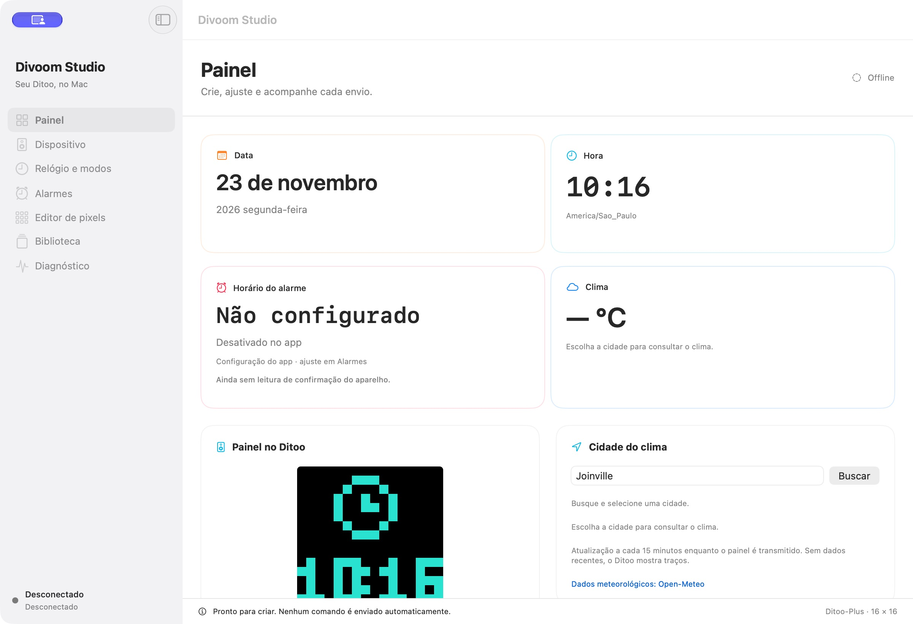
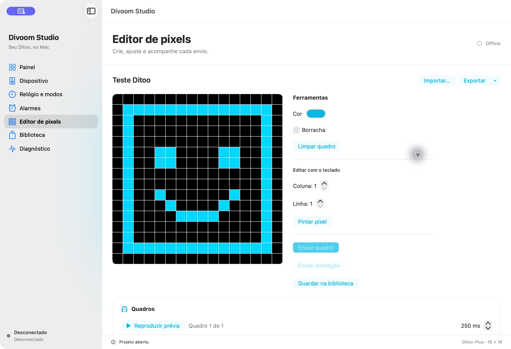

# Divoom Studio para macOS

Aplicativo nativo SwiftUI para controlar o Ditoo-Plus por Bluetooth Classic. Construído e executado neste Mac com Xcode27/Swift6. A conexão e o envio de uma imagem foram confirmados no aparelho pelo usuário.

## Atualização macOS 0.3.0

Reconexão automática ao último Ditoo conectado, clima salvo para reabrir offline, dias/volume do alarme persistentes e envio de uma página do painel. O ciclo do painel pode continuar entre seções, com botão Parar sempre disponível; queda de conexão, suspensão ou fechamento da janela interrompem os envios até você iniciá-los novamente.

A conexão automática não repete comandos nem transmite conteúdo por conta própria. Conecte uma vez nesta versão para salvar o aparelho; Desconectar desativa a reconexão e Esquecer remove o vínculo local. O Mac mantém o transporte RFCOMM e os controles adicionais de iluminação.

Esta etapa atualiza a instalação local e os fontes; não publica uma nova release ou Cask.

## Companion iPhone

O target **DivoomStudioMobile** oferece painel, clima/cidade, editor de pixels, biblioteca, relógio, alarmes e diagnóstico no iPhone(iOS17+). Usa CoreBluetooth e o canal BLE/Light do Ditoo, com protocolo próprio separado do RFCOMMdo Mac. [Instalação e limites da versão iPhone](docs/IPHONE.md).

A transmissão do painel pausa ao sair do primeiro plano. A versão iPhone melhora a proximidade da conexão, mas não instala código personalizado no firmware nem torna hora/clima autônomos no Ditoo.

## Instalar

Requer macOS 14 ou posterior. Binário universal para Intel e Apple Silicon.

```sh
brew install --cask ronanrodrigo/tap/divoom-studio
```

Também disponível em [Releases](https://github.com/ronanrodrigo/divoom-studio/releases). O app tem assinatura ad-hoc e ainda não é notarizado pela Apple; o macOS pode exigir autorização em **Ajustes do Sistema → Privacidade e Segurança → Abrir Mesmo Assim** após a primeira tentativa de abertura.

## Prints

### Painel de data, hora, alarme e clima



### Editor de pixels



## Abrir

Abra **Divoom Studio** em Aplicativos. Ele não depende do Python, blueutil ou do daemon MiniToo.

1. Deixe o Ditoo ligado e pareado com este Mac.
2. Abra o app, escolha **Dispositivo → Conectar**.
3. Em **Relógio e modos**, ajuste estilo/cor/12–24h e clique **Aplicar relógio**. Sincronização do horário e brilho são ações separadas.
4. Em **Alarmes**, configure horário, dias, volume e ativação do primeiro alarme. Clique **Enviar configuração do alarme** apenas quando quiser substituir essa configuração no aparelho. O disparo físico ainda não foi testado.
5. Em **Editor de pixels**, desenhe ou abra `Examples/Teste-Ditoo.json` pelo menu Arquivo. **Enviar quadro** atualiza a tela; animações usam vários frames e a duração escolhida.
6. **Diagnóstico** mostra tráfego e respostas e permite exportar registro.

Se o perfil de áudio impedir a conexão, desconecte o Ditoo nos ajustes Bluetooth e tente Conectar no app. Um celular conectado ao app Divoom também pode ocupar o canal.

## Painel de data, hora, alarme e clima

A tela inicial reúne as quatro informações no Mac. Busque a cidade e selecione o resultado (Joinville inicialmente), conecte o Ditoo e clique **Exibir no Ditoo** para alternar as quatro telas pixeladas. Mantenha o painel aberto para atualizações. O horário do alarme é a configuração do app, sem leitura de confirmação do aparelho. [Detalhes do painel](docs/DASHBOARD.md).

## O que está pronto

- Conexão RFCOMM assíncrona, cancelamento, timeouts e logs; nenhum envio automático na inicialização.
- Relógio com6 estilos, cor,12/24h, sincronização do horário, brilho e modos de tela.
- Iluminação RGB/efeitos, variações VJ e visualizador de música.
- Primeiro alarme(slot0), ativar/desativar, hora/minuto, repetição por dia e volume.
- Editor16×16 com pincel/borracha/edição por teclado; até60frames e preview.
- Importar PNG/JPEG/GIF com orientação EXIF e recorte central; exportar PNG/GIF.
- Salvar/abrir projetos JSON e biblioteca local em Application Support/DivoomStudio/Library.

GIFs com durações variáveis são normalizados para a duração do primeiro frame, com aviso no app. Envios de animação têm limites de tamanho;60frames coloridos podem exceder o limite do protocolo e serão recusados.

## Validação e limites

A suíte Xcode cobre protocolo, mídia, renderização do painel e clima; os registros históricos estão em `docs/`. Os testes cobrem vetores do protocolo e roundtrips de mídia. Conexão e imagem estática foram testadas pelo app final: o usuário confirmou que a imagem apareceu e o aparelho continuou normal. Nem todo estilo/modo e nem o disparo de alarme foram validados fisicamente.

O IPA iOS está criptografado por FairPlay. A investigação inventariou recursos com REA e identificou o limite da análise; o codec Ditoo foi reconstruído de implementações públicas com fontes fixadas por commit e comparação byte a byte. O formato MiniTooLCD/Zstandard que causou travamento foi excluído deste app.

Esta versão não integra comunidade/login/galeria online, jogos, sleep, rádio, placar ou atualização de firmware. A matriz completa e o trabalho restante estão em [docs/PARITY.md](docs/PARITY.md). Selecionar o canal nuvem do aparelho não acessa o backend da comunidade.

## Projeto e testes

Pré-requisitos de desenvolvimento: Xcode 27 e XcodeGen (`brew install xcodegen`).

```sh
./Scripts/build.sh
./Scripts/test.sh
open DivoomStudio.xcodeproj
```

`project.yml` é a fonte do projeto. Swift6, concorrência completa, Hardened Runtime e avisos do compilador estão configurados. O script gera o app Release e aplica assinatura ad-hoc para execução local. Não há servidor TCP nem backend próprio. O projeto não usa App Sandbox devido à integração Bluetooth Classic; os arquivos escolhidos são processados localmente.

## Documentação

- [Metas](docs/OBJECTIVES.md)
- [Plano](docs/PLAN.md)
- [Validação física e testes](docs/HARDWARE-VALIDATION.md)
- [Paridade e próximas funções](docs/PARITY.md)
- [Revisão independente](docs/REVIEW.md)
- [Revisão do transporte](docs/REVIEW-BLUETOOTH.md)
- [Atribuições](docs/THIRD_PARTY.md)

As skills Apple `swiftui-specialist` orientaram estado/estrutura/APIs. A skill AvdLee citada na nota foi lida como complemento para UI macOS. Não houve mudança global de configuração do Xcode ou instalação de MCP.
